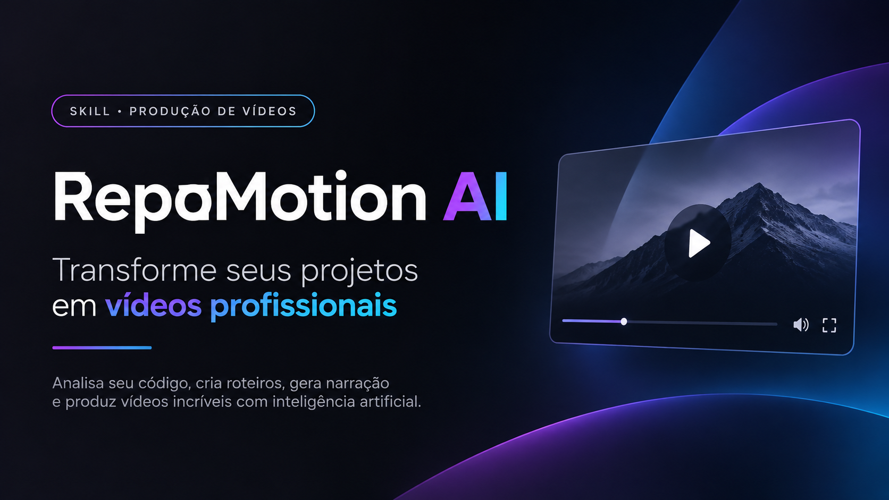

# RepoMotion AI — Motion Frames 

**Skill & Ferramenta de IA para Produção Audiovisual Comercial e Motion Design Profissional** — Crie anúncios, publis, promos de produto, vídeos explicativos e demonstrações cinematográficas para TikTok, Instagram Reels, Shorts, LinkedIn e YouTube.

---

## ⚡ Como Usar (Simples e Direto)

Basta carregar esta skill no chat com o seu assistente ou agente de IA favorito (**Muse, Claude, ChatGPT, Gemini, Antigravity, Cursor, entre outros**):

1. **Jogue o projeto/pasta ou envie um documento/README** do seu produto, software ou repositório no chat.
2. **Explique ou peça o que você precisa**:
   > *"Usa essa skill para criar um vídeo comercial de 15s no estilo Modern Advertising sobre o meu projeto..."*
   > ou
   > *"Gera uma animação de anúncio vertical baseada nesse documento que enviei..."*
3. **A IA faz todo o resto**: analisa a documentação, escreve o roteiro comercial sem clichês, projeta o storyboard quadro a quadro (60 FPS), sintetiza a trilha sonora original sem direitos autorais, ajusta a narração e entrega a animação pronta para renderizar.

---

## 🎥 Vídeos Demonstrativos


---

## 🌟 O que é o RepoMotion

O RepoMotion AI opera como um **estúdio audiovisual autônomo completo**:

1. **Inteligência de Roteirização Baseada em Evidências do Código**:
   - Analisa arquivos reais (`README.md`, `package.json`, stack e documentações anexadas).
   - Elimina frases genéricas e clichês vazios (*"você já imaginou..."*, *"o futuro chegou..."*).
   - Estrutura narrativa comercial validada: **Hook → Contexto → Demonstração Real → Benefício → CTA**.
   - Orçamento milimétrico de palavras por segundo e tempo de leitura confortável.

2. **Direção Musical Original (Livre de Direitos Autorais / Copyright-Free)**:
   - Síntese de composições próprias procedurais em WAV 48 kHz estéreo sem samples de terceiros.
   - 5 estilos refinados adequados para publis e publicidade:
     - **Modern Advertising**: Elegante, piano elétrico suave, pads quentes e pulso pop leve.
     - **Soft Electronic**: Apps e tecnologia, sintetizadores aéreos, arpejos delicados e sub-bass controlado.
     - **Minimalist Lifestyle**: Publis e bem-estar, piano de feltro, violão acústico e percussão sutil.
     - **Ambient Cinematic**: Vídeos institucionais e branding premium, texturas imersivas e evolução emotiva.
     - **Light Funk / Groove**: Anúncios dinâmicos, linhas de baixo suaves e sincopadas com balanço comercial.
   - Arranjo com seções harmônicas estruturadas (*intro*, *verse*, *build*, *main*, *breakdown*, *outro*) e final resolvido na tônica.
   - Gerador de prompts musicais detalhados para APIs de áudio generativo.

3. **Sistema Inteligente de Narração & Voz Natural**:
   - Dicionário fonético com pronúncia calibrada para termos técnicos em português (`AI`, `API`, `GitHub`, `Node.js`, `Docker`, `SQL`, `SaaS`).
   - Geração automática de SSML neural com controle de velocidade, pausas respiratórias e entonação.
   - 5 perfis de voz profissionais:
     - **Comercial Premium**: Seguro, suave, elegante e confiante.
     - **Conversacional**: Próximo, espontâneo e amigável (estilo criador de conteúdo / publis).
     - **Tecnológico**: Moderno, claro e objetivo para software e plataformas digitais.
     - **Lifestyle**: Descontraído, acolhedor e natural.
     - **Narrativo**: Envolvente com variações de ritmo para vídeos explicativos.
   - Suporte a provedores neurais (OpenAI Voice, ElevenLabs) e sintetizador local offline integrado para operação sem internet.

4. **Sincronização e Mixagem Audiovisual Padrão Broadcast**:
   - **Ducking Automático**: A música atenua suavemente durante a fala (-9 dB com curvas de ataque e release antecipadas).
   - **Bolsão de Frequência (Voice Pocket EQ)**: Corte sutil na música em 2.5 kHz para destacar a voz sem precisar abaixar drasticamente a trilha.
   - **Masterização EBU R128 / ITU-R BS.1770-4**: Normalização precisa a **-14 LUFS** e limitador com lookahead para **True Peak em -1.0 dBTP** (volume padrão de redes sociais, sem distorção).
   - Adaptação temporal contínua (`music_fit`) para músicas externas sem cortes secos ou loops repetitivos.

5. **Auditoria e Relatório Automático de Qualidade (QA)**:
   - Emissão de relatório detalhado (`QA_REPORT.md`) avaliando clipping, true peak, relação voz/música, densidade de micro-eventos e legibilidade visual.

---

## 🚀 Instalação Local (Opcional para Execução por Código)

Requisitos: Python 3.10+ e Node.js 18+.

```bash
# 1. Instale as dependências de processamento de áudio
python -m pip install numpy scipy

# 2. O Chromium ou Google Chrome instalado no seu sistema é detectado automaticamente para renderização
```

---

## 🛠️ Utilização por Código / CLI

### 1. Produção Automatizada Completa de um Projeto

```python
from pipeline.audiovisual.planner import produce_video_project

# Produz um anúncio de 15 segundos para Reels/TikTok a partir do código do repositório
resultado = produce_video_project(
    repo_path=".",                          # Caminho do repositório ou pasta
    output_dir="./producao_video_comercial", # Pasta de saída dos artefatos
    duration_s=15.0,                        # Duração: 10s, 15s, 30s ou 60s
    content_type="ad",                      # ad, publi_app, publi_product, demo, repo_presentation
    platform="reels",                       # reels, tiktok, shorts, youtube, linkedin
    voice_profile="commercial_premium",     # commercial_premium, conversational, technological
    music_style="modern_advertising"        # modern_advertising, soft_electronic, minimalist_lifestyle, etc.
)

print(resultado["status"])  # Retorna 'SUCCESS' e gera o QA_REPORT.md
```

### 2. Geração e Síntese de Trilha Musical via CLI

```bash
python pipeline/sfx_kit.py test_production_out/music_timeline.json trilha_final.wav --stems stems/
```

### 3. Execução dos Testes Automatizados

```bash
python -m unittest pipeline/tests/test_audiovisual.py
```

---

## 📁 Arquitetura do Pacote Audiovisual (`pipeline/audiovisual/`)

| Módulo | Responsabilidade |
|---|---|
| `config.py` | Presets centrais, plataformas (aspect ratios, LUFS), perfis de voz, estilos musicais e limites de QA. |
| `evidence.py` | Extração de fatos, features e stack a partir de arquivos reais do repositório/documentos. |
| `script.py` | Roteirização comercial sem clichês, orçamentos de tempo e validação de ritmo. |
| `narration.py` | Normalização de termos técnicos, formatação de SSML, estimativa de fala e sintetizador offline. |
| `music.py` | Direção musical, geração de prompt contextual e timeline estruturada de seções. |
| `music_fit.py` | Adaptação contínua e crossfade em grade métrica de trilhas externas. |
| `storyboard.py` | Planejamento de cenas, câmeras, física de transição e micro-eventos a cada ~1s. |
| `audio_mix.py` | Motor de loudness BS.1770, true peak, ducking dinâmico, Voice Pocket EQ e limitador. |
| `qa.py` | Inspeção técnica automática de áudio, vídeo e texto com geração de relatório Markdown. |
| `planner.py` | Orquestrador de ponta a ponta que integra todas as etapas. |

---

## 📄 Licenciamento e Direitos Autorais

Todas as trilhas geradas pelo sintetizador interno `pipeline/sfx_kit.py` são **obras procedurais originais**, livres de royalties e com uso comercial 100% liberado. Nenhuma melodia de terceiros é reproduzida ou amostrada.
